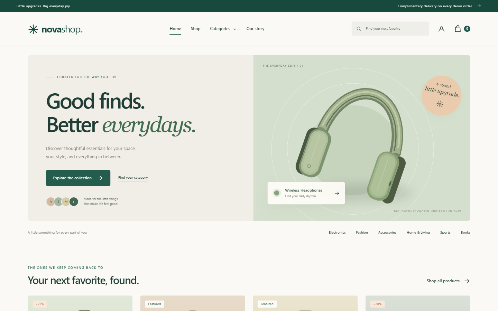
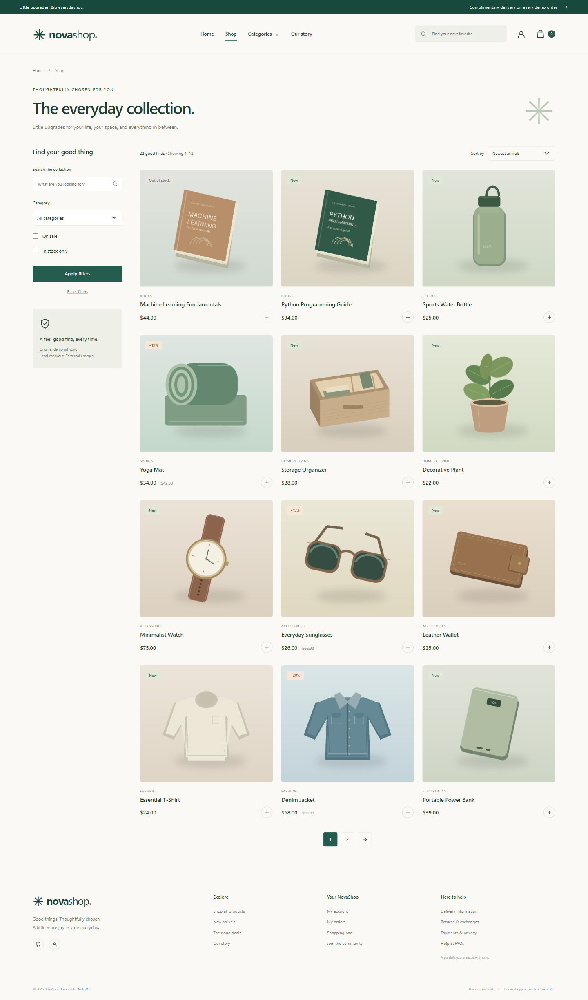
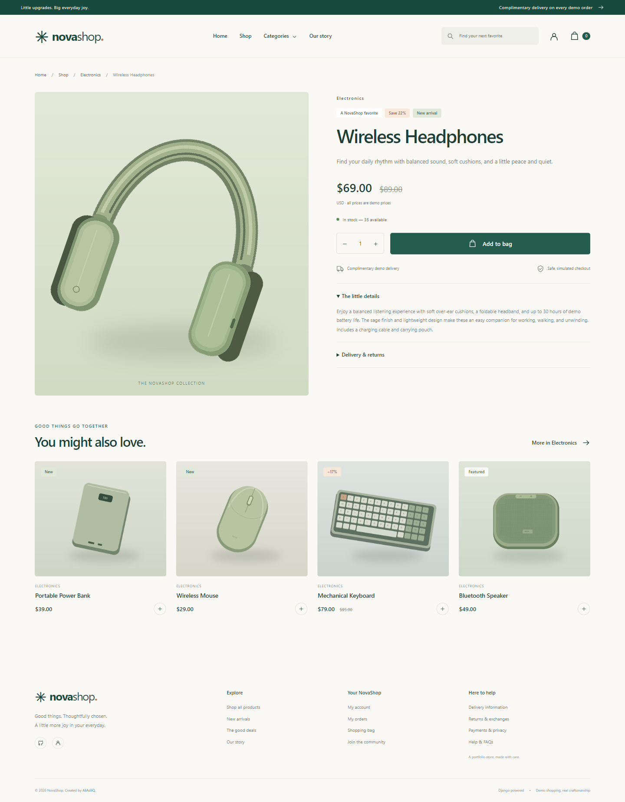
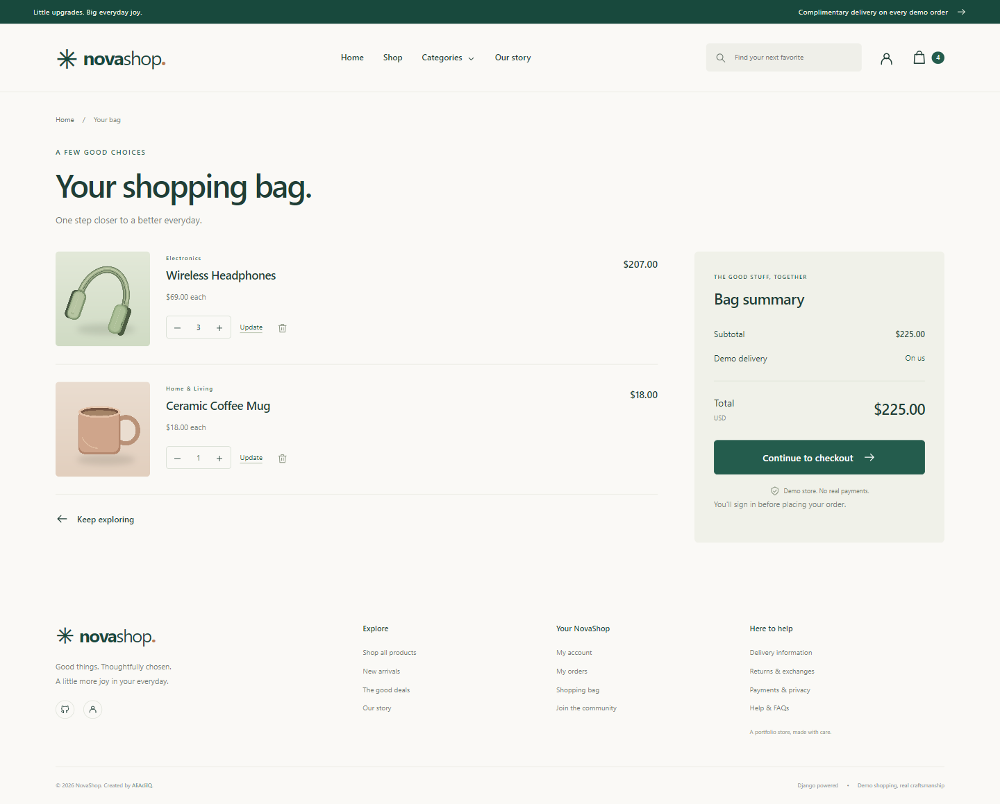
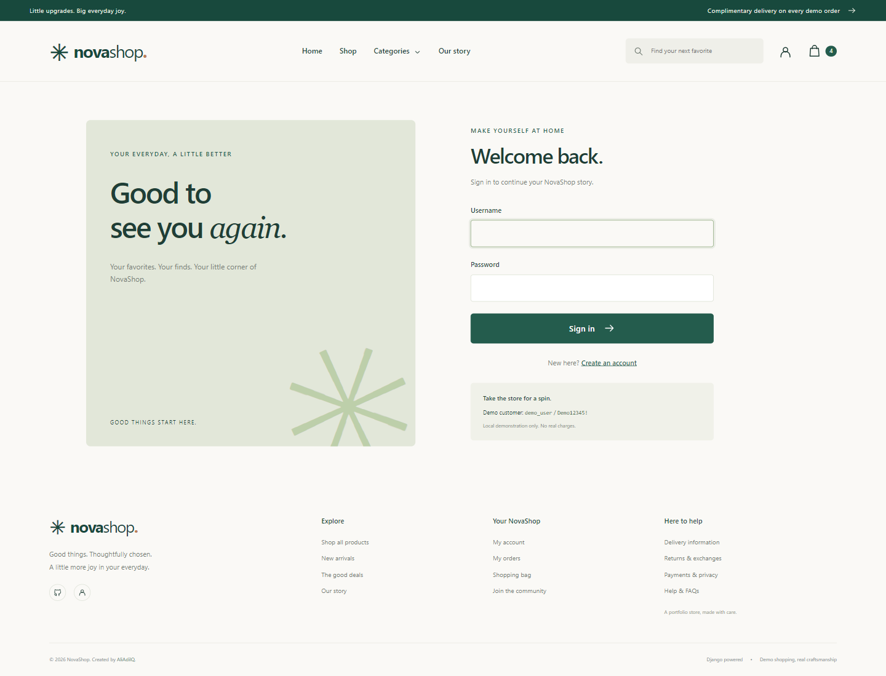
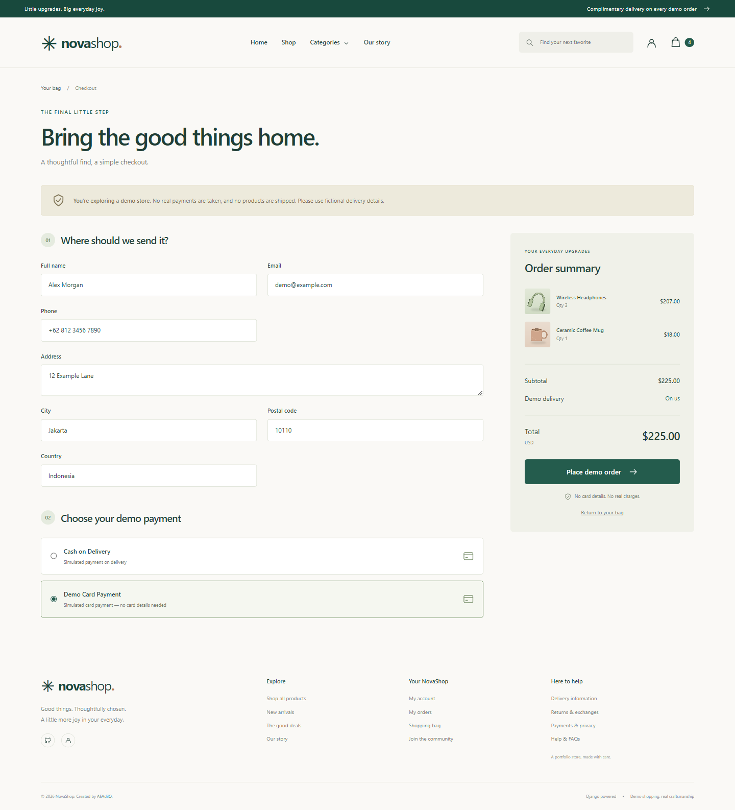
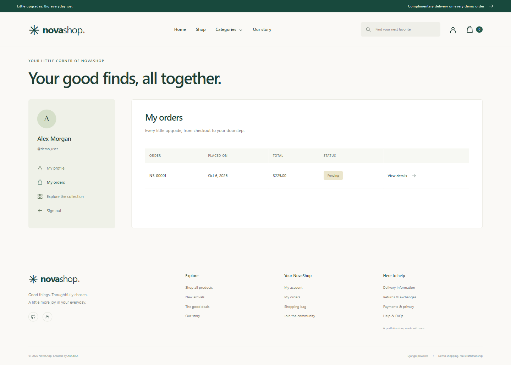
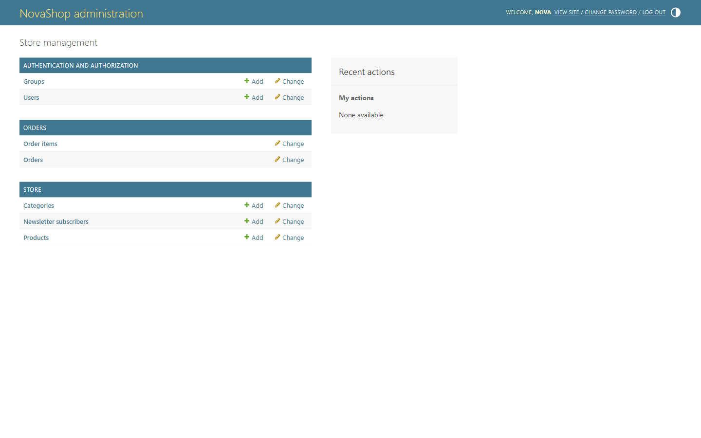
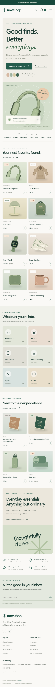

# Django E-Commerce Website


**NovaShop — good finds, better everydays.**

A complete, responsive e-commerce portfolio project built with **Django, Python, Bootstrap, and SQLite**. An original cream-and-sage storefront brings together a curated catalog, guest shopping bags, customer accounts, and a fully working simulated checkout. All product artwork and frontend assets are local, so the installed store works offline.

Repository: [AliAdilQ/django_e_commerce_website](https://github.com/AliAdilQ/django_e_commerce_website)



## Screenshots

Actual screenshots of the running application, captured in Chromium at a **1440 × 900 desktop viewport**. Cart, checkout, and order history use the demo customer and fictional delivery information. The mobile screenshot uses **390 × 844**.

<details>
<summary><strong>Browse the collection and product details</strong></summary>





</details>

<details>
<summary><strong>Shopping bag, sign in, and checkout</strong></summary>







</details>

<details>
<summary><strong>Order history and store administration</strong></summary>





</details>

<details>
<summary><strong>The mobile storefront</strong></summary>



</details>

## Features

- **A curated storefront:** hero, eight featured products, latest arrivals, category cards, shopping benefits, and a local newsletter subscription form.
- **A useful catalog:** six categories, 22 realistic demo products, slug URLs, descriptions, sale badges, current prices, and visible stock status.
- **Search and discovery:** search names, descriptions, and categories; combine category, sale, and availability filters; sort by newest, effective price, or name; browse 12 products per page.
- **Guest shopping bags:** add, increase, decrease, update, and remove quantities, with server-side stock checks, line subtotals, total, and navigation item count.
- **Customer accounts:** registration, validated sign in, POST-only logout, profile editing, and private order history.
- **Complete demo checkout:** delivery form, Cash on Delivery or Demo Card Payment, order confirmation, stock deduction, and cart clearing.
- **Reliable orders:** atomic creation, conditional inventory updates, immutable price/name snapshots, and duplicate-submission protection.
- **Store administration:** searchable and filterable products, editable stock and featured flags, slug prepopulation, category management, order item inlines, and editable order status.
- **Thoughtful interface:** responsive navigation, original product illustrations, SVG icons, semantic markup, accessible form labels, reduced-motion support, messages, and styled 404/500 pages.
- **Reproducible demo:** migrations, an idempotent seed command, local artwork generation, pinned application dependencies, and 39 automated Django tests.

## Technologies Used

| Layer | Technology |
| --- | --- |
| Language | Python 3.10+ (verified with Python 3.12) |
| Backend | Django 5.2.17, Django ORM, built-in authentication |
| Database | SQLite3 |
| Templates | Django Template Engine, HTML5 |
| Styling | Bootstrap 5.3.8 with original CSS3 |
| Interactions | Vanilla JavaScript |
| Artwork / uploads | Pillow 12.3.0, Django ImageField |

The application has no frontend build step or JavaScript runtime requirement. Bootstrap is vendored in `static/vendor/`, including its MIT license. Product artwork is generated with Pillow and contains no external product photographs or commercial branding.

## Installation

### 1. Clone the repository

```bash
git clone https://github.com/AliAdilQ/django_e_commerce_website.git
cd django_e_commerce_website
```

### 2. Create and activate a virtual environment

Use **Python 3.10 or newer**. If `python --version` reports an older release, choose a newer interpreter when creating the environment.

Windows (Command Prompt):

```bat
python -m venv venv
venv\Scripts\activate
```

Windows (PowerShell):

```powershell
python -m venv venv
.\venv\Scripts\Activate.ps1
```

macOS / Linux:

```bash
python3 -m venv venv
source venv/bin/activate
```

### 3. Install the application dependencies

```bash
pip install -r requirements.txt
```

### 4. Configure the environment (optional locally)

Local development works immediately without a `.env`. To customize it, copy `.env.example` to `.env`:

```powershell
# Windows PowerShell
Copy-Item .env.example .env
```

```bash
# macOS / Linux
cp .env.example .env
```

The settings read simple `KEY=value` entries. Existing environment variables take precedence.

| Variable | Local default | Purpose |
| --- | --- | --- |
| `DJANGO_SECRET_KEY` | Clearly marked development-only key | Supply a private random key outside development |
| `DJANGO_DEBUG` | `True` | Enables local debug mode and media serving |
| `DJANGO_ALLOWED_HOSTS` | `localhost,127.0.0.1,[::1]` | Comma-separated hostnames |

The `.env.example` key `change-me` uses the development fallback while debug is enabled. With `DJANGO_DEBUG=False`, an absent or placeholder key raises a configuration error. Never commit a real `.env`.

### 5. Create the database and demo catalog

```bash
python manage.py migrate
python manage.py seed_demo
```

The seed command creates six categories, 22 products, two demo accounts, and original PNG illustrations in `media/products/demo/`. It is safe to run repeatedly: existing stock, prices, descriptions, passwords, and orders are preserved. Missing demo image files are regenerated. Existing accounts with the same username are kept as they are.

### 6. Start NovaShop

```bash
python manage.py runserver
```

Storefront: [http://127.0.0.1:8000/](http://127.0.0.1:8000/)

Admin: [http://127.0.0.1:8000/admin/](http://127.0.0.1:8000/admin/)

If port 8000 is already in use, choose a free port, for example `python manage.py runserver 8001`, and open that port instead.

## Demo Accounts

Admin:

```text
Username: admin
Password: Admin12345!
Email: admin@example.com
```

Customer:

```text
Username: demo_user
Password: Demo12345!
Email: demo@example.com
```

> These credentials are provided only for local demonstration purposes. Do not use them in a production deployment.

`seed_demo` intentionally requires `DJANGO_DEBUG=True`. It will not reset a changed password or elevate an existing account. To create your own administrator, use `python manage.py createsuperuser`.

## Usage

1. Browse the homepage, open a category, or search for a product.
2. On Shop, combine filters and sorting or move to the next page.
3. Open a product, choose a quantity, and add it to your bag. The bag works before sign in.
4. Update quantities or remove products on the bag page.
5. Continue to checkout. Guests are redirected to sign in and their bag is retained.
6. Enter **fictional delivery details**, choose either demo payment option, and place the order.
7. View the confirmation, order history, and private order details in your account.
8. Sign in as the demo administrator to edit the catalog or update order status.

All prices are in **USD**. Demo delivery is free; totals consist of the current product prices multiplied by quantities, with no added demo taxes or fees. Neither payment method collects money or card details, and no products are shipped. Newsletter subscriptions are saved in SQLite; no emails are sent.

Orders start as **Pending**. Admins can change them to Processing, Shipped, Delivered, or Cancelled. Changing an order's status does not automatically refund or replenish inventory. Previously placed orders retain their item names and prices even when a product changes or is deleted.

A fresh clone has an empty order history; the screenshots show an order placed through the real demo checkout flow.

## Project Structure

```text
django_e_commerce_website/
├── manage.py
├── requirements.txt
├── .env.example
├── .gitignore
├── LICENSE
├── README.md
├── ecommerce/                  # Settings, root URLs, WSGI and ASGI
├── store/
│   ├── models.py               # Categories, products, local newsletter
│   ├── cart.py                 # Guest session cart and live totals
│   ├── views.py / forms.py
│   ├── demo_art.py             # Original Pillow illustration generator
│   ├── demo_data.py            # Realistic catalog and descriptions
│   ├── management/commands/seed_demo.py
│   ├── migrations/
│   └── tests.py
├── accounts/                   # Authentication and profile forms/views/tests
├── orders/
│   ├── models.py               # Order and snapshot order items
│   ├── services.py             # Atomic checkout and inventory validation
│   ├── views.py / forms.py
│   ├── migrations/
│   └── tests.py
├── templates/
│   ├── base.html
│   ├── includes/
│   ├── store/ accounts/ orders/
│   └── 404.html / 500.html
├── static/
│   ├── css/style.css
│   ├── js/main.js
│   ├── images/                 # Hero, fallback artwork and favicon
│   └── vendor/                 # Offline Bootstrap CSS, JS and license
├── media/products/             # Demo images generated by seed_demo
└── docs/screenshots/           # Actual browser screenshots
```

`db.sqlite3`, uploaded/generated media, virtual environments, cache files, and local secrets are excluded from Git. Migrations and the deterministic seed command recreate the database and product images. This keeps the repository free of local sessions and personal order data.

## Testing

```bash
python manage.py check
python manage.py migrate
python manage.py seed_demo
python manage.py test
```

**Verified: 39 Django tests pass.** The suite covers the homepage, catalog, categories, product details, search, effective-price sorting, pagination, discounts, registration, login/logout, profile validation, guest carts, POST-only mutations, CSRF, safe redirects, stock changes, checkout, rollback, repeated submissions, order ownership, historical snapshots, styled errors, admin access, and seed idempotency.

The tests use an isolated test database and temporary generated artwork. They do not consume the local demo catalog's stock.

Browser verification also covered the complete guest-to-customer checkout flow, registration, profile updates, order details, admin login, desktop and mobile navigation, image loading, horizontal overflow, and JavaScript errors. All screenshots in this README are from that running application.

## Implementation Notes

- The cart stores only product IDs and validated quantities in the server-side session. Prices and totals are recalculated from the database.
- Checkout uses `transaction.atomic()`, SQLite's `IMMEDIATE` transaction mode, and conditional stock updates. Any unavailable item rolls back the entire order and inventory changes.
- A per-checkout UUID and unique database constraint protect against duplicate form submissions.
- Every order lookup is scoped to the authenticated owner. Item name, image path, and price are saved as snapshots.
- Django forms, ORM queries, CSRF middleware, built-in password hashing/validation, and POST-only cart/logout actions provide the security foundation.
- SQLite is a deliberate local portfolio choice. The Django development server and public demo accounts are not a production deployment plan. A real deployment needs private credentials, HTTPS, a suitable application server, proper static/media hosting, backups, and environment-specific settings.
- The 404/500 pages are used when debug mode is disabled. The 500 template stands alone so a database error does not prevent it from rendering.

## License

This project and its original illustrations are licensed under the [MIT License](LICENSE). Bootstrap is included under its own [MIT license](static/vendor/BOOTSTRAP-LICENSE.txt).

## Author

**AliAdilQ**

GitHub: [@AliAdilQ](https://github.com/AliAdilQ)

---

If you found this project useful, consider giving the repository a ⭐.
